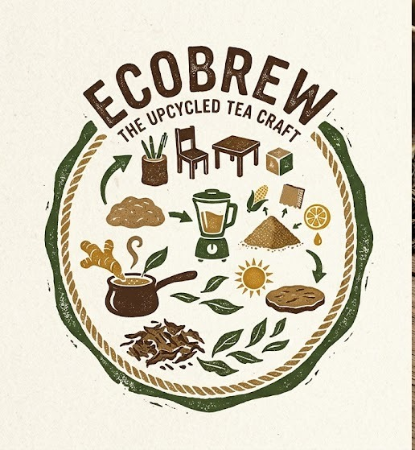

<p align="center">
  
</p>

<h1 align="center">EcoBrew</h1>

<p align="center">
  <b>Spent tea leaves make useful things.</b><br />
  A student brand that upcycles waste tea leaves into pen stands, stationery,
  mini furniture, and decor. A social-science project for Bal Vigyan, India.
</p>

<p align="center">
  <a href="https://ecobrew-live.vercel.app"><b>🌿 Live demo →</b></a>
</p>

---

A Next.js e-commerce storefront (App Router, TypeScript, Tailwind) with a
Supabase backend. Users can browse a hand-shaped catalog, add items to a cart,
check out, create an account with Google, and track their orders — while an
admin panel manages the catalog and order fulfilment.

## ✨ Features

- **Catalog** — nine hand-shaped products across four categories (pen stands,
  stationery, furniture, decor), each with environmental impact notes.
- **Cart & checkout** — a client-side cart with a smooth drawer, multi-step
  checkout (shipping → payment → review), and order confirmation.
- **Accounts** — "Continue with Google" via Supabase Auth (PKCE) with a secure,
  signed, httpOnly session cookie. Orders are tied to your account.
- **My orders** — track order status (pending → approved → in transit →
  delivered) and delivery dates.
- **Admin panel** — password-protected dashboard with a DB-backed catalog
  (add / edit / delete products), order management, and a customer contact inbox.
- **Realtime** — product and order changes push live via Supabase Realtime.
- **SEO & content** — generated sitemap (includes live product pages), robots.txt,
  per-page metadata, and a cookie-consent banner with a full cookie policy.
- **Design** — an organic, biophilic design system (deep leaf greens, moss,
  kraft, oat) with Fraunces + Public Sans typography.

## 🧱 Tech stack

| Layer | Choice |
| --- | --- |
| Framework | [Next.js 16](https://nextjs.org) (App Router) |
| UI | React 19 + Tailwind CSS v4 + Framer Motion |
| Icons | lucide-react |
| Database / Auth | Supabase (Postgres + Auth + Storage + Realtime) |
| Deployment | Vercel (GitHub auto-deploy) |

## 🔒 Security model

All database **writes** (order placement, admin product/order/contact actions,
image uploads, account signup/login) go through server-side API routes under
`src/app/api/` that authenticate the caller (HMAC-signed httpOnly account /
admin / Google cookies). Row Level Security is locked down so the **anon**
key can only read products and submit contact messages — it cannot read or
write users, orders, or the contact inbox.

**Required environment variables** (see `.env.example`):

| Variable | Public? | Purpose |
| --- | --- | --- |
| `NEXT_PUBLIC_SUPABASE_URL` | yes | Supabase project URL |
| `NEXT_PUBLIC_SUPABASE_ANON_KEY` | yes | Public anon/publishable key |
| `NEXT_PUBLIC_SITE_URL` | yes | Deployed origin (OAuth redirect + sitemap) |
| `ECOBREW_SESSION_SECRET` | no | Signs all httpOnly session cookies |
| `SUPABASE_SERVICE_ROLE_KEY` | no | Server-only writes (bypasses RLS) |
| `ADMIN_PASSWORD_HASH` | no | Admin password as an scrypt hash (no default) |

Before first use:

1. Put real values in `.env.local` (copy `.env.example`).
2. Run `supabase/migrations/20261105000000_security_hardening.sql` in the
   Supabase SQL editor to apply the RLS lockdown (and `supabase/schema.sql`
   for a fresh project).
3. Generate an admin hash with
   `node -e "const{scryptSync,randomBytes}=require('crypto');const s=randomBytes(16).toString('base64');const h=scryptSync(process.argv[1],s,64).toString('base64');console.log('scrypt:'+s+':'+h)" 'your-password'`
   and set `ADMIN_PASSWORD_HASH` to it.

## 🔑 Google Sign-In setup

"Continue with Google" uses Supabase Auth with PKCE (redirect to a Google login
page, then back to `/auth/callback`). To make it work:

1. Set `NEXT_PUBLIC_SUPABASE_URL` and `NEXT_PUBLIC_SUPABASE_ANON_KEY` (or
   `NEXT_PUBLIC_SUPABASE_PUBLISHABLE_KEY`) in the deployed environment.
2. Set `NEXT_PUBLIC_SITE_URL` to your deployed origin (e.g. `https://ecobrew-live.vercel.app`).
3. In **Supabase → Auth → URL Configuration → Redirect URLs**, add
   `${NEXT_PUBLIC_SITE_URL}/auth/callback`.
4. In **Supabase → Auth → Providers**, enable **Google**; in Google Cloud,
   add `https://<project-ref>.supabase.co/auth/v1/callback` as an authorized
   redirect URI.
5. Set `ECOBREW_SESSION_SECRET` (>= 16 chars) — it signs the httpOnly session
   cookie; without it the callback fails and Google login won't complete.

## 🚀 Getting started

Prerequisites: Node.js 20+, npm, and a [Supabase project](https://supabase.com).

```bash
npm install
cp .env.example .env.local   # then fill in the values above
npm run dev
```

Open [http://localhost:3000](http://localhost:3000).

> **Note for ARM / Android (e.g. Termux):** Turbopack has no native bindings
> for `arm64` Android, so build with webpack instead:
> `npm run build -- --webpack`.

## 🛠 Scripts

| Script | Action |
| --- | --- |
| `npm run dev` | Start the dev server |
| `npm run build` | Production build |
| `npm run start` | Serve the built app |
| `npm run lint` | ESLint |

## 📦 Deployment

Deployed on Vercel; auto-deploys from the `master` branch. The production
environment must define all variables above. Because `NEXT_PUBLIC_*` values are
inlined at build time, changing them requires a redeploy.

## 🧑‍🔬 Project background

EcoBrew is a school project exploring sustainable consumption: instead of
discarding used tea leaves (chaipatti), they are dried, bound with natural
binders, and pressed into useful everyday objects. Every product is
compostable at end of life — nothing new, nothing wasted.

---

<p align="center">
  <sub>© 2026 EcoBrew · A student project · Presented at Bal Vigyan, India</sub>
</p>
